# 🇨🇦 Canada FIRE Calculator

**English** · [Français](README_FR.md) · [中文](README_CN.md)

A FIRE (Financial Independence, Retire Early) calculator built **specifically for
Canadians**. Generic 4%-rule tools ignore everything that actually decides a Canadian
early retirement: account tax treatment (TFSA / RRSP / non-registered), CPP/QPP and
OAS timing, RRIF forced minimums, the OAS clawback, withdrawal-order strategy, and
what happens to an RRSP at death. This calculator models all of it.

**Live demo: <https://leoli-dev.github.io/canada-fire-calculator/>**

**Privacy-first: a pure frontend app.** No backend, no account, no AI. Your numbers
never leave the browser (they persist to `localStorage`, and the app still runs, with
a notice, when site storage is blocked). Anonymous usage statistics (page views,
feature clicks, never your inputs) are **opt-in**: Google Analytics loads only after
you allow it, a Global Privacy Control or Do Not Track signal counts as a no, and the
footer lets you change your answer. English / Français / 中文.

**Two ways in.** *Guided* mode walks you through short question pages in eight
categories (family, saving, assets, housing, spending, income, preferences and an
optional tax-details category), lets you jump around freely, then shows a review page
before it generates results. *Professional* mode is the full form with live results.
Both edit the same plan, so you can switch at any time, and one confirmed
"Reset all data" clears it in either mode.

**Looking for the new annual details?** The [illustrated walkthrough](#annual-ledger-walkthrough)
shows where to open the table, when to enable the optional **Canonical annual ledger**,
and what to enter in each of its fields.

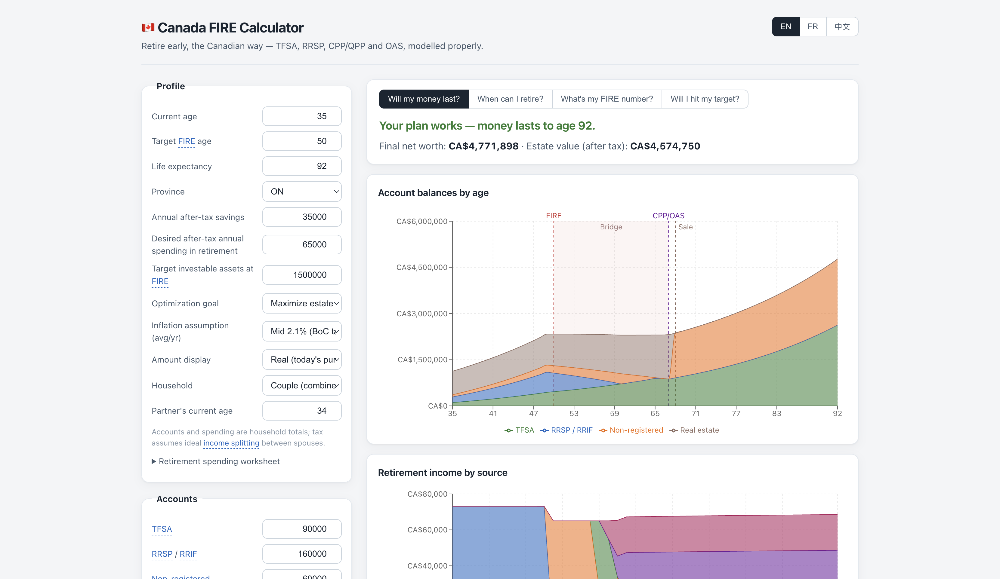

## Quick start

```sh
npm install
npm run dev      # local dev server
npm test         # unit tests (vitest)
npm run test:e2e # end-to-end tests (Playwright, desktop and 320px phone)
npm run build    # type-check + production build
```

The calculation engine (`src/engine/`) is a pure, UI-free TypeScript module: every
number in the UI comes from a deterministic, unit-tested year-by-year simulation.
Tax and benefit figures live in dated, versioned rule packs under
`src/engine/rules/`, each field tied to the official source it was read from (see
[docs/rule-coverage.md](docs/rule-coverage.md) and, for the quarterly OAS/GIS update,
[docs/quarterly-benefit-refresh.md](docs/quarterly-benefit-refresh.md)).

## Annual ledger walkthrough

**Just want the year-by-year table?** Generate results in **Guided**, or open the
live results in **Professional**, then choose **Annual financial details**. You can
do this with the existing planning estimate. Its full-screen table is labelled
**Household annual estimate**.

**Want to see which person or account a number belongs to?** Open **Canonical
annual ledger** in the input area and record the living budgets below. This is an
optional calculation mode for supported Ontario plans anchored in 2026. It uses
the recorded facts in your plan, including account ownership, contribution room
and benefit information where needed. If a fact is missing or a transaction cannot
be modelled, the result shows where calculation stopped.

[Budget setup](#1-set-the-living-budgets) · [Results and full-screen table](#3-read-the-results-and-open-the-table)
· [Retirement comparisons](#4-try-a-retirement-age-or-budget) · [Monte Carlo](#5-run-monte-carlo)

The English screenshots below were captured in Thorium using an illustrative
Ontario household with staggered retirement. The amounts illustrate how to read
the interface.

### 1. Set the living budgets

In **Professional**, expand **Canonical annual ledger** under the inputs. In
**Guided**, open it on the **Review** page. Enter household totals **per year in
2026 purchasing power**, even when the results are displayed in nominal dollars.

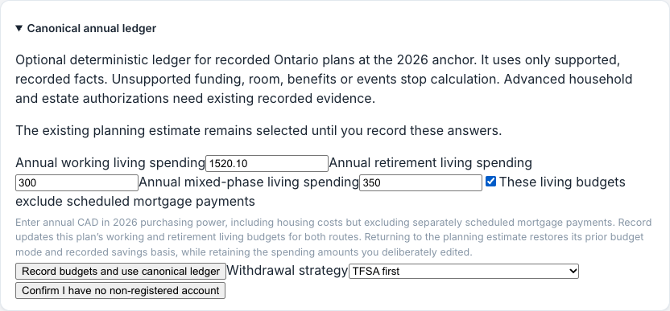

| Field or control | What to enter or choose |
| --- | --- |
| **Annual working living spending** | Your yearly living costs while working. For a couple, enter the household total while both are working. Include ordinary housing costs, groceries, transport and other living expenses. |
| **Annual retirement living spending** | Your yearly living costs after retirement. For a couple, enter the household total after both retire. Record pensions and benefits in their own inputs so the ledger can apply them as income. |
| **Annual mixed-phase living spending** | For a couple, enter the yearly household total for the period when one person is working and the other is retired. The field appears for couples and must be filled to record their budgets, even if their retirement dates coincide. A solo plan has no mixed-phase field. |
| **These living budgets exclude scheduled mortgage payments** | If the plan has a separately recorded mortgage, exclude its scheduled payments from the living amounts and check this box to confirm. The ledger pays that mortgage on its own line. With no mortgage, the box can remain unchecked. |
| **Withdrawal strategy** | Sets the plan's withdrawal preference when investments are needed to fund spending. The menu offers non-registered first, paced RRSP withdrawals, RRSP first and TFSA first. Availability depends on the plan and the year. For example, paced RRSP withdrawals can stop a canonical retirement calculation. |
| **Confirm I have no non-registered account** | Use this only if you actually have no taxable investment account. The button appears when the displayed non-registered balance is zero. The confirmation lets the ledger skip an empty placeholder account. A real account can have a zero balance and still belong in the plan. |

For example, a couple could enter **$54,000** while both work, **$49,000**
during staggered retirement and **$45,000** after both retire. If a separately
recorded mortgage costs **$18,000 a year**, leave that amount out of all three
figures and check the mortgage box. Enter `0` only when the amount really is
zero. A blank required budget or an unconfirmed mortgage exclusion keeps the
record button disabled.

Select **Record budgets and use canonical ledger**. This updates the plan's
shared working and retirement spending values as well as choosing the ledger.
In **Professional**, the result updates with the plan. In **Guided**, return to
**Review**, finish any unanswered questions, then select **Generate my results**.

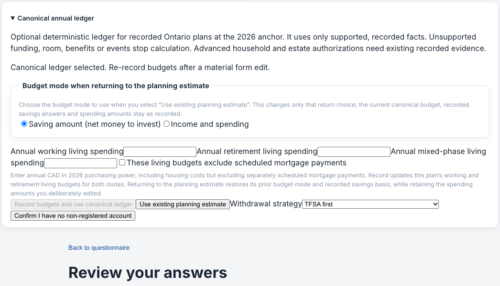

### 2. Switch back or keep a scenario

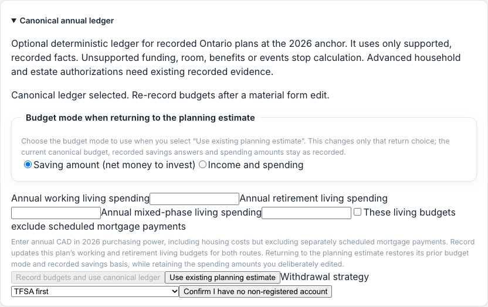

- **Budget mode when returning to the planning estimate** picks the budget basis
  for the next time you switch back. Choose **Saving amount (net money to invest)**
  to use your annual investable savings, or **Income and spending** to use the
  recorded income and expenses. This choice leaves the current ledger untouched.
- **Use existing planning estimate** switches the result back. It restores the
  saved return mode and any recorded savings-basis answers. Amounts you deliberately
  edited are retained. If an older plan has no recorded return mode, switching
  back keeps its current budget mode unless you choose one first.
- **Scenario A** can save, restore or clear a plan. Side-by-side legacy comparison
  is unavailable when either scenario uses the canonical ledger. A material
  form edit can require recording the living budgets again. If the app warns
  that advanced authorizations were dropped during a plan rebuild, re-entering
  budgets only confirms the budgets. A saved scenario can restore its original
  recorded facts.

### 3. Read the results and open the table

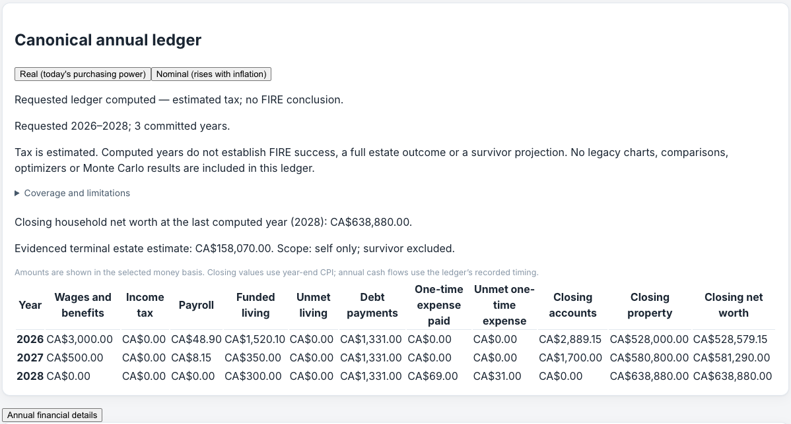

| On the result card | How to read it |
| --- | --- |
| **Real / Nominal** | **Real** shows base-year purchasing power. **Nominal** shows dollars in the displayed year. The toggle changes how amounts are shown. Year-end balances use year-end inflation, and cash flows follow their recorded timing. |
| **Requested years / committed years** | Requested years are the full projection horizon. Committed years are the ones the ledger finished. Open **Coverage and limitations** to see which rules and facts supported the run. |
| **Wages and benefits / Income tax / Payroll** | Cash from work and benefits, estimated income tax, and payroll deductions. View **Annual financial details** for the underlying person or category where available. |
| **Funded living / Unmet living / Debt payments** | Living costs paid, living costs still unfunded, and separately scheduled debt payments. A living shortfall indicates an amount the model could not fund in that year. |
| **One-time expense paid / Unmet one-time expense** | The amount paid and the separate funding gap for a modelled event. In the example, 2028 has **$0** unmet living costs and a **$31** one-time expense gap. |
| **Closing accounts / Closing property / Closing net worth** | Year-end account and property totals, followed by net worth after debts and with any tracked sale cash. The headline shows the last **computed** year's net worth. |
| **Evidenced terminal estate estimate** | Appears when the terminal year and the required estate facts support an estimate. Read the stated scope. The example shows **$638,880** in household closing net worth and **$158,070** for the modelled person's estate, with the surviving partner outside that estate scope. |

Choose **Annual financial details** below the summary. Years are columns and
people, accounts, property, debts and events are grouped into rows. Expand a row
group to see its components. Use **Jump to year**, scroll the table, or click an
amount directly. With the keyboard, choose a year and use the row's **Cell details**
button. The detail panel shows the status, amount, timing, conversion and any
available source or formula. Press **Esc** or **Close** to return to results.

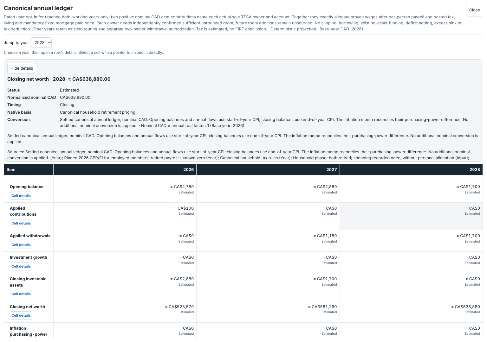

**When a year stops:** Start with **First blocked year** and the reason beneath
the summary. For example, the following run committed 2026 and 2027, stopped in
2028, and left 2029 and 2030 uncomputed. Earlier figures remain visible. If the
first year is blocked, there are no committed rows to review. If the page
reports invalid inputs, correct the listed errors and generate the result again.
In the table, **Unknown** means a value is unavailable, **Not applicable**
means the item does not apply, and **Not computed** means the calculation did
not reach a result for that year. A displayed zero in a computed year is an
amount. A completed ledger means the model processed its requested years.
Read the separate gaps before interpreting it.

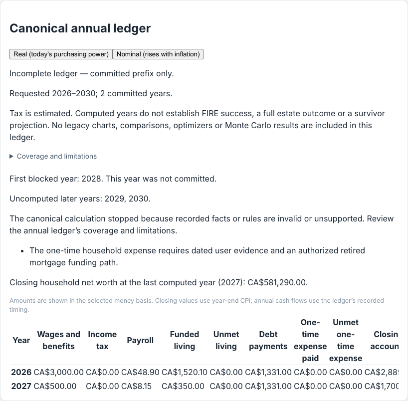

### 4. Try a retirement age or budget

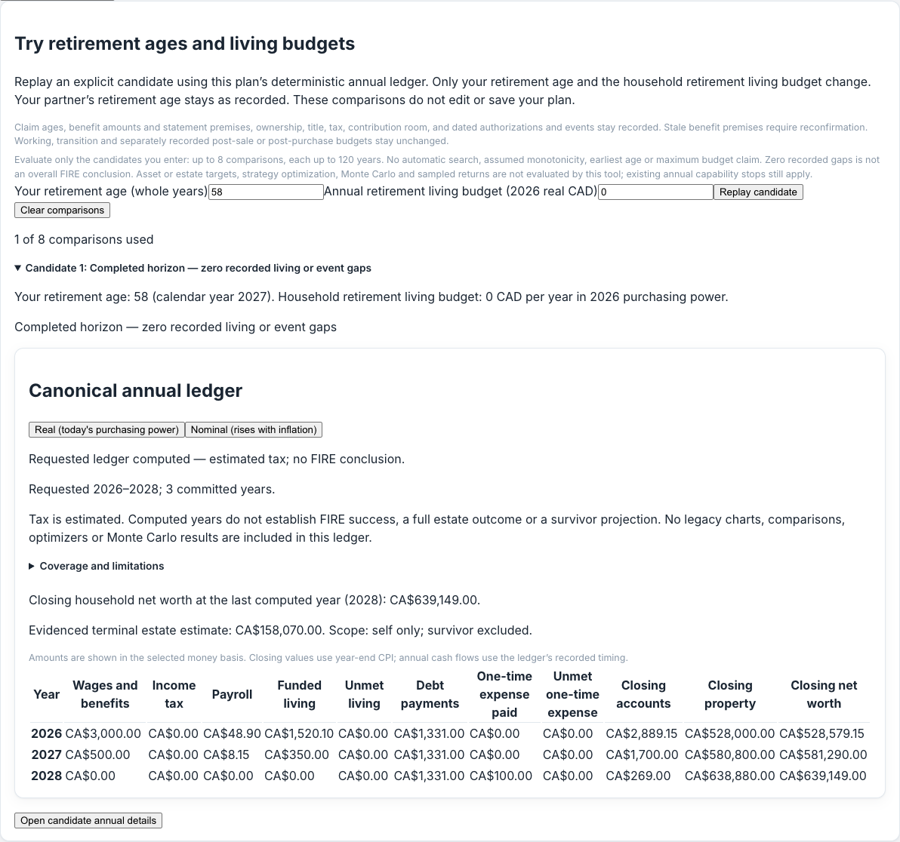

| Field or control | What it does |
| --- | --- |
| **Your retirement age (whole years)** | Enter your proposed retirement age. Your partner's recorded date stays the same. A change can require you to reconfirm CPP/OAS statement assumptions in the source plan. |
| **Annual retirement living budget** | Enter the proposed annual household retirement spending in base-year CAD. The working, mixed-phase and separately recorded post-sale or post-purchase budgets retain their own amounts. |
| **Replay candidate** | Runs those two inputs through the same ledger on a separate copy. The result reports completed years, living and event gaps, or a stop. You can explicitly test up to eight comparisons. |
| **Open candidate annual details / Clear comparisons** | Inspect the selected comparison's own ledger or clear the comparison list. Neither action edits your source plan. |

Replay the prefilled values to reproduce the source result. Then change one field
to see its effect. The screenshot uses a **$0** retirement budget as a test case.
The tool reports outcomes for the scenarios you enter. See the recorded gaps
and coverage before comparing them.

### 5. Run Monte Carlo

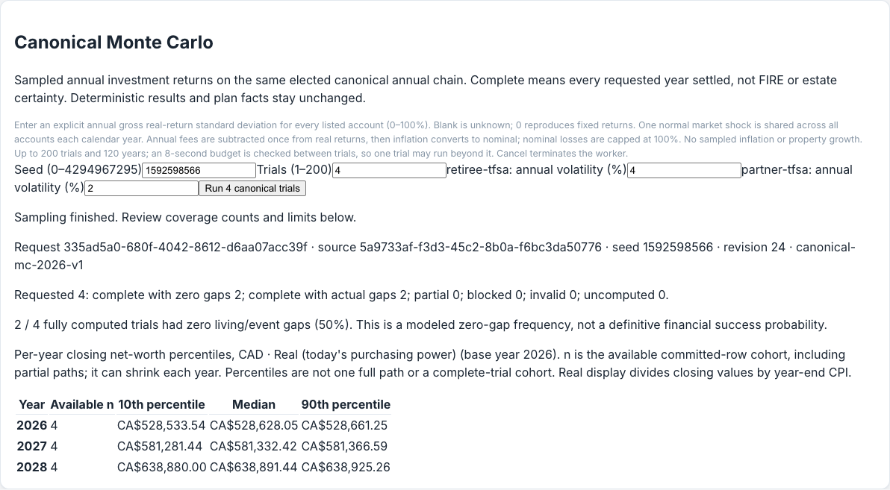

| Field or control | What to enter or choose |
| --- | --- |
| **Seed** | A whole number from **0 to 4,294,967,295**. Reuse the same seed with the same plan, assumptions and count to replay the run. |
| **Trials** | The number of simulated paths, **1–200**. The default is 100. |
| **Annual volatility (%)** | For each listed account, enter how variable its annual real investment return is, as a percentage from **0 to 100**. Enter `12` for 12%. Enter `0` to keep that account on fixed returns. A blank is unknown and blocks Run. |
| **Run / Cancel** | Run starts the selected number of trials in the background. Cancel stops the worker and discards the run's results. The worker checks its eight-second budget between trials, so unfinished trials may remain. |

All accounts share the same market shock in a given year, scaled by their own
volatility. With every account at **0%**, the simulation replays the fixed-return
ledger. Inflation and property appreciation stay at the plan's recorded
assumptions. Nonzero sampling can stop for unsupported calculations such as some
exact purchase or recorded non-registered investment paths.

Read the **trial counts** first. A complete path can have zero gaps or actual
living or event gaps. Partial, blocked, invalid and uncomputed trials each have
their own counts. The overall zero-gap percentage is available when all
requested trials complete. In the table, **n** is the number of paths that
actually finished that year. **P10**, **P50** (median) and **P90** summarize
those paths' ending net worth for that year. The cohort can shrink over time,
and each percentile is a separate annual statistic. The run also shows its seed
and revision so you can identify the assumptions behind the result.

## What it calculates

The next sections describe the existing planning estimate and its tools. For
the optional canonical calculation, see the walkthrough above.

**A three-phase, year-by-year simulation** in real (inflation-adjusted) dollars:

1. **Accumulation** (now → FIRE): after-tax savings flow into TFSA / RRSP /
   non-registered by your allocation.
2. **Bridge** (FIRE → CPP/OAS): the low-income window. Spending is funded by account
   withdrawals following your strategy; each year the engine solves (binary search)
   for the gross withdrawal that nets your after-tax spending target.
3. **Pension** (CPP/OAS → life expectancy): government benefits arrive; from age 72
   RRIF minimum withdrawals are forced whether you need them or not — for couples,
   the minimum is computed from the younger spouse's age (the spousal age election),
   auto-applied since it's always the better choice.

**The tax engine** applies real federal + provincial marginal brackets (all 13
provinces and territories, 2026 figures, data-driven and updated yearly), the basic
personal amounts (with the federal, Manitoba and Yukon high-income phase-outs),
Quebec's federal abatement, Ontario's surtax and health premium, Quebec's RAMQ
prescription-drug premium and FSS contribution, the age amount from 65 and the
pension income credit (employer pension annuities qualify at any age, RRIF
withdrawals from 65 — including Saskatchewan's senior supplement), 50% capital-gains
inclusion tracked against your ACB, annual tax drag on non-registered distributions,
per-person OAS clawback (75+ rates included), GIS for low-taxable-income retirees
priced from the latest quarterly ESDC tables for each household shape (single, both
spouses on OAS, a spouse on the Allowance, a spouse with neither), with a work
exemption per earner and the Allowance for a 60-64 spouse, probate/estate
administration fees on death, and, for couples, income splitting across two returns
(pension splitting also flows through to the OAS clawback and the age-qualified
pension credits). In Québec it adds the amount for a person living alone and the
transfer of a spouse's unused basic personal credit (TP-1 line 431). Post-FIRE side
income pays its 2026 payroll: CPP/QPP, CPP2/QPP2, EI and, in Québec, QPIP, with
self-employed income paying both CPP halves. A per-jurisdiction coverage matrix in
the app lists which credits each priced number includes, the authority each figure
comes from, and what is left out.

**Withdrawal strategies**, compared side by side with your own numbers:

- **Bracket-capped RRSP meltdown** (default): the RRSP funds spending first, but only
  up to a chosen ceiling's room left after CPP/OAS (one ceiling per spouse) —
  the lowest tax bracket by default, or the second bracket / OAS clawback
  threshold for large RRSPs where staying in bracket 1 forever just strands
  money into RRIF-forced withdrawals and a fully-taxable estate. The remainder
  rides past 71 and exits via RRIF minimums. Nothing is withdrawn just to
  prepay tax.
- Aggressive RRSP-first, non-registered-first, TFSA-first — so you can see exactly
  what each choice costs.

**Estate honesty**: at death the remaining RRSP/RRIF is fully taxable in the final
year and half of unrealized gains is taxed (TFSA and the principal residence pass
free); non-registered holdings and unsold real estate also owe probate/estate
administration fees (each of the 13 jurisdictions priced from its own published
fee statute or regulation; registered accounts bypass it via named beneficiary).
Capital gains are measured against a nominal ACB ledger, and the final return taxes
the year of death as incremental income, keeping terminal capital losses. Strategies are therefore ranked by
**after-tax estate value** — or, under the **Die-with-Zero** goal, by the
maximum sustainable annual spending.

**Also modelled**: an **employer DB pension** per spouse (lifetime annuity at a
chosen start age, partial-CPI indexing, and a bridge benefit that ends at 65 —
taxed as pension income, splittable at any age, visible to the OAS clawback and
GIS; a separate **Locked DC/LIRA** account keeps restricted pension money out of
the bridge until its plan-specific withdrawal age), an **FHSA**
household side account (contributions carved out of annual savings, growth
tracks the RRSP assumption, and it rolls tax-free — either into a home purchase
or, failing that, into the RRSP at 15 years/age 71, whichever comes first),
principal-residence sale (tax-free, e.g. downsizing at a chosen age) **or a
planned future purchase** (down payment funded FHSA → TFSA → non-registered →
RRSP, a fixed order; an RRSP draw for a first home goes through the **Home Buyers'
Plan**, tax-free up to $60,000 per buyer and repaid at 1/15 a year from the second
year after the purchase, with any instalment your savings can't cover taxed as
income; a mortgage for the rest amortizes from the purchase year),
any number of investment properties — each sellable at its own age (gain
taxed) or kept for **net rental income** (taxed as ordinary income, visible to the
OAS clawback and GIS) — optionally leveraged with a **mortgage tied to that specific
property**, discharged from the sale proceeds and with its interest (not principal)
deductible against the rent, **debts** (mortgage / car loan / other: the engine
back-solves each loan's implied rate and lets inflation erode the fixed nominal
payments — payments join retirement spending until paid off, balances reduce net
worth and the estate), **Barista-FIRE side income** over a chosen age range
(employment, self-employment or other, with payroll withheld and the official GIS
work exemption), the **Canada Child Benefit (CCB)** for households
with children — tax-free, income-tested like GIS (but the household income measure
includes OAS, unlike GIS), computed only from FIRE age on, since pre-FIRE CCB is
assumed already folded into annual savings — CPP/QPP estimation from work history
(best-39-years rule with the claim-age dropout divisor — early retirement dilutes
your average, and claiming early dilutes it less than you'd think), OAS from
residence years and its automatic +10% at 75, CPP 60–70 (QPP to 72) / OAS 65–70
timing tables, investment fees (MER), and a Monte Carlo simulation (1,000
randomized-return runs in a web worker, one shared market shock per year across
accounts) with a failure-anatomy readout. Inputs are validated as you type —
impossible age orderings, negative amounts, out-of-window claim ages and
never-amortizing loans are flagged inline.

## How to fill in the inputs

In Professional mode, work down the left column; in Guided mode the same fields come
one short page at a time, each with its own help. Every underlined term opens a
plain-language explanation (see the glossary drawer below).

- **Profile** — ages, province, after-tax annual savings, desired after-tax annual
  spending in retirement (today's purchasing power; a spending worksheet helps you
  build it from categories). Pick an **optimization goal**: maximize the after-tax
  estate, or **Die with Zero** (maximize stable spending, end near zero). The
  inflation assumption and Real/Nominal toggle only change how amounts are
  *displayed* — the math always runs in real dollars.
- **Household** — couple mode treats accounts and spending as household totals and
  taxes the income split across both spouses (two personal amounts, two runs up the
  low brackets). Each partner has their own CPP/OAS timeline.
- **Accounts** — current balances per wrapper. Couples enter the combined total for
  both of you, then say whose name each account is in (or the amount each person
  holds); until that's confirmed, results that depend on who owns what are shown as
  labelled estimates. For the non-registered account also
  enter the **ACB** (your broker calls it *book cost*, including reinvested
  distributions and later purchases): tax applies only to the gain above it, so a
  guessed percentage cannot support precise capital-gains tax. Leave it unknown
  until you can verify it; a cost above today's value is a loss whose eligibility
  must be confirmed before results rely on it. Asset-mix presets set realistic
  real returns and volatilities per account.
- **FHSA** — a household-combined bucket (enter the couple's total, not per spouse):
  today's balance, annual contribution (carved out of annual savings before it's
  split across TFSA/RRSP/non-registered), and years since the account was opened
  (contribution room only starts building that year, unlike a TFSA). It ends at the
  earliest of a qualifying home purchase, 15 years, or age 71.
- **Real estate** — a principal-residence card in one of two modes — **already
  own** (current value, appreciation, optional sale age) or **planned purchase**
  (purchase age, price and down payment in today's dollars, an auto-derived
  mortgage from payment + years, and a net $/year holding-cost change) — plus any
  number of investment properties, each with an optional sale age, optional selling
  expenses in today's dollars (charged once against proceeds — land/building split
  and CCA recapture stay unmodeled, so a sale withholds precise tax conclusions), and
  an optional net annual rent (rent minus operating costs; it stops the year the
  property sells). A principal-residence sale is tax-free and becomes investable
  capital the same year; a planned purchase's down payment is funded FHSA → TFSA →
  non-registered → RRSP, a fixed order that isn't configurable. The Home Buyers'
  Plan is on by default for the RRSP part and can be switched off for the purchase.
- **Debts** — mortgage, car loan or other, each as (balance, annual payment, years
  remaining). Enter your annual savings as what you actually save *after* debt
  payments; the engine adds the payments to retirement spending until each loan
  is gone.
- **Side income** — optional post-FIRE income (Barista FIRE) with an age range and
  a type (employment by default, self-employment, or other income with no payroll);
  don't subtract it from retirement spending yourself.
- **Children** — optional, one row per child with their current age; enables the
  Canada Child Benefit (CCB) from FIRE age on. The CCB you already collect while
  working is assumed to already be part of annual savings, so nothing is
  double-counted.
- **Government benefits** — CPP/QPP and OAS start ages and age-65 amounts, per
  spouse. Not sure of the amounts? Use the built-in estimators (work history for
  CPP, residence years for OAS) or copy the exact figures from My Service Canada
  Account. Each amount remembers where it came from: an estimate is re-priced when
  you change your FIRE age, while a figure from your statement is never rewritten
  and is flagged for review instead.
- **Employer pension** — optional, per spouse: the lifetime annual amount from
  your pension statement (already reduced for an early start), start age, CPI
  indexing percentage, and any bridge benefit (paid until 65). Have a DC plan or
  a LIRA? Use the separate Locked DC/LIRA account instead. It remains unavailable
  until the earliest withdrawal age you enter.
- **Tax details** (optional) — the facts a precise per-person tax result needs:
  each spouse's employment income, account types (RRSP, RRIF, LIF) and who holds
  them, TFSA, RRSP and FHSA room from each person's CRA statement, spousal RRSP
  contribution history, and in Québec the drug-insurance status and whether you
  lived alone. The panel keeps a per-person room ledger for each account and shows
  any planned contribution above the recorded room; unknown room is never treated as
  unlimited or as zero. Skip it and results stay available, with the parts that need
  these facts marked as estimates.

## How to read the outputs

**The four question tabs** at the top answer, with method notes under each answer:
*Will my money last?* · *When can I retire (earliest feasible age)?* · *What's my
FIRE number (assets needed at FIRE, vs what you're projected to have)?* · *Will I
hit my asset target (and at what age)?* On a phone they form a 2 × 2 grid, and a
headline above the form jumps straight to the full results.

A plan that runs out of money says so plainly: the age it runs out, the first
shortfall, why, and what you could change. When the plan is missing a fact that a
precise answer needs (unconfirmed account ownership, an unknown ACB, a working
couple or a Québec household without per-person tax details), the summary, charts
and benefit panel stay visible as labelled estimates; only the precise tax tools
(tax tables, strategy and timing rankings, Monte Carlo) wait until the fact is
filled in. A collapsible *rule sources* line under the form and on the review page
names the rule packs, years and official sources behind the numbers.

**Account balances by age** — stacked wealth by wrapper. Dashed lines mark FIRE, the
first government benefit, and any planned property sale; the tinted region is the
bridge period. Watch the blue RRSP melt away during the bridge while the green TFSA
compounds untouched — that is the withdrawal strategy at work.

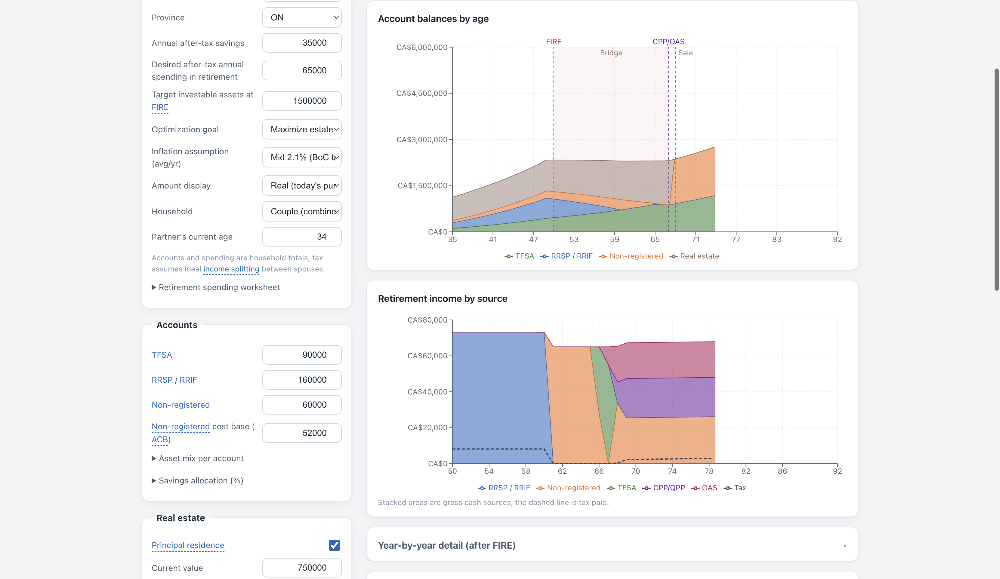

**Retirement income by source** — where each year's cash comes from (stacked) and
the tax paid (dashed line). The handoff pattern — RRSP first, then non-registered,
TFSA last, benefits layering in on top — is the plan's story in one picture.

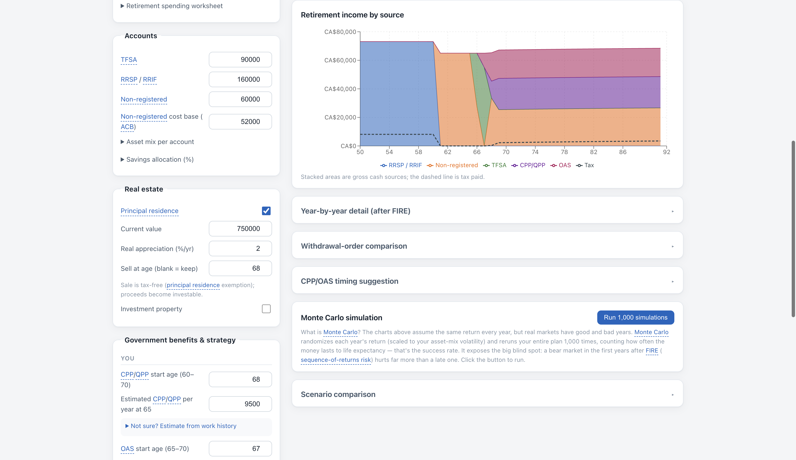

**Tax composition by source** — right below it, the same dashed tax line broken down
into a stacked chart: how much of this year's tax comes from RRSP withdrawals,
non-registered gains/distributions, CPP/QPP, OAS, rental/property-sale income, or
Barista-FIRE side income. It's a proportional allocation, not a statutory one (Canada
taxes all income together on one bracket ladder), but the slices always sum exactly
to the tax line above. Hovering a point also shows taxable income per person, the
average tax rate, and the marginal bracket for that year.

**Year-by-year detail** (collapsed by default) — the compact table for the existing planning estimate: every retirement
year's withdrawals per account, benefits, gross, tax, after-tax cash, taxable income
per person and the marginal bracket it lands in.

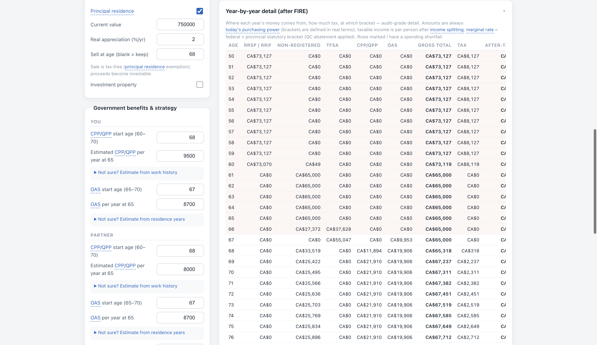

**Withdrawal-order comparison** — all four strategies on your numbers: total tax
(including estate tax), tax paid on RRSP/RRIF money specifically, and the ranking
metric for your goal. One click applies any row. This comparison and the CPP/OAS
timing scan run in a background worker, and only while their panel is open, so
typing stays fast.

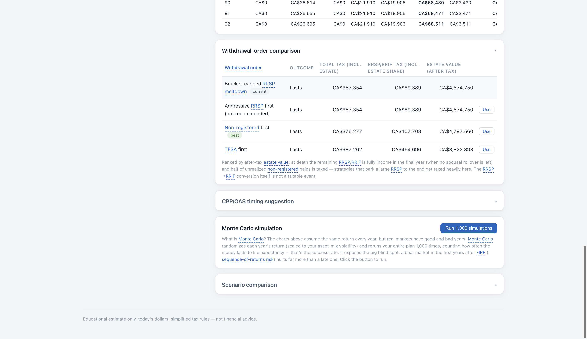

**CPP/OAS timing** — full tables for every start age (CPP 60–70, OAS 65–70): the
adjusted annual benefit, the plan outcome, and the delta versus your current choice.

**Scenario A/B** — save your current inputs as Scenario A, then change anything and
compare outcome-vs-outcome (plan success, after-tax estate) against your current
numbers, side by side. A restore button brings Scenario A back as your current
inputs at any time, so exploring a what-if never costs you your baseline.

**Monte Carlo** — randomizes each year's returns and reruns the whole plan 1,000
times. The success rate is the share of runs that last to life expectancy; the
failure-anatomy panel shows how the unlucky runs actually fail (almost always: a bear
market in the first five years after FIRE — sequence-of-returns risk), and the chart
overlays the single worst-case trajectory — the run that depleted earliest — on top
of the percentile bands.

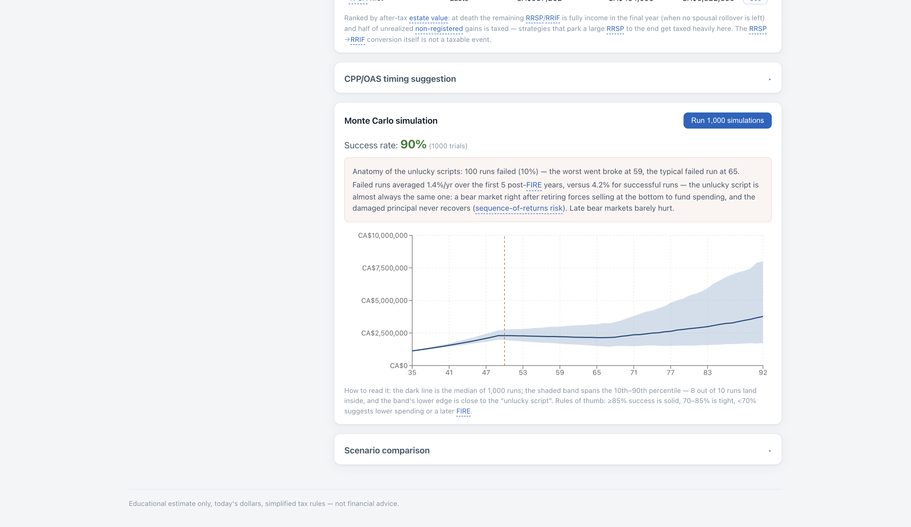

**The glossary drawer** — every underlined term on the page (RRSP, ACB, meltdown,
clawback, marginal rate, …) opens a plain-language explanation; terms inside
explanations are clickable too. 40 entries in all three languages.

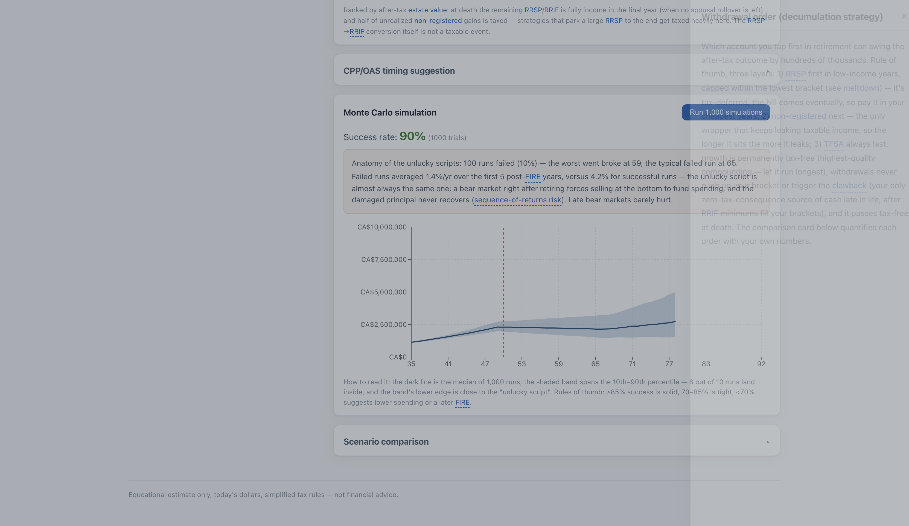

## Assumptions and limitations

- All amounts are **today's purchasing power**; returns are real (net of inflation).
  Tax brackets are held in real terms.
- Tax data: 2026 federal + all-province/territory tables from CRA's T4032 guides,
  Québec's fiscal parameters and provincial statutes, held in dated rule packs with a
  source on every field and updated manually each year. OAS, GIS and the Allowance
  use the latest published quarter (currently October to December 2026). The
  projection uses the 2026 pack in every future year; it doesn't switch to per-year
  packs yet.
- Couple taxation assumes ideal 50/50 income splitting for CPP/RRSP/rental/investment
  income. In reality, pre-65 RRSP withdrawals are taxed to the account owner — an
  even split during the bridge requires comparable RRSP balances (plan ahead with a
  spousal RRSP). Barista-FIRE side income is the exception: it's taxed entirely on
  you, since employment-type income can't legally be split with a spouse.
- Québec: a single Québec owner gets an estimated closing tax from simplified Québec
  rules, disclosed under the estate figure, so strategies and claim ages can be
  ranked as estimates. Closing tax for a Québec couple isn't supported yet, so their
  estate ranking stays withheld; the Die-with-Zero goal ranks by sustainable spending
  and doesn't need it.
- Non-registered distributions and net rent are taxed yearly as ordinary income (a
  deliberate simplification: no dividend gross-up/credit, no rental CCA); GIS uses a
  linear approximation of the official tables; enter your annual savings **after
  tax and after debt payments** — the RRSP refund is not recycled automatically.
- Debt payments are treated as fixed in nominal dollars (no refinancing or variable
  rates); the interest rate is implied from balance / payment / years. A mortgage
  can be attached to a specific property instead of the general debt list — it's
  then discharged from the sale proceeds and its interest (not principal) is
  deductible against that property's rent, rather than continuing forever.
- The FHSA's contribution deduction isn't modelled as a separate refund, consistent
  with "the RRSP refund isn't recycled automatically" above. The Home Buyers' Plan
  covers only the RRSP part of a planned first-home down payment (up to $60,000 per
  buyer, the CRA limit for withdrawals after April 16, 2024); repayments come from
  savings, and a balance still owed at death is taxed on the final return. A planned purchase's down payment is always funded
  FHSA → TFSA → non-registered → RRSP, in that order — this isn't configurable, even
  if a different order would be more tax-efficient for a given household. The net
  holding-cost-change field is whatever you say it is (e.g. property tax and
  maintenance minus rent saved) — it excludes the mortgage payment, which is
  handled like any other mortgage.
- Employer pensions are simplified: survivor percentages aren't modelled (both
  spouses are assumed to reach the shared life expectancy), Quebec's provincial
  rule requiring age 65+ for pension splitting is ignored (splitting stays
  idealized at any age), a partially-indexed pension erodes only from its start
  age (deferral-period erosion isn't modelled). A locked DC/LIRA side account
  grows but is completely unavailable until the user-entered earliest withdrawal
  age; after that v1 treats it as a normal taxable registered account. Its
  jurisdiction is retained for a future LIF model, but v1 does **not** model LIF
  annual minimums/maximums, special unlocking, or 50% unlocking.
- Contribution room is recorded and checked in the Tax details panel, but the main
  projection doesn't yet clip planned TFSA/RRSP/FHSA contributions to that room.
  Future-year room additions also stay unknown: the TFSA limit is indexed in $500
  steps and the RRSP 18%-of-earnings rule isn't in the rule pack, so room is only as
  good as the CRA statement you enter.
- Not yet modelled: dividend tax credits, the CPP enhancement (post-2019
  contributions; estimates lean conservative for younger users), long-term-care
  cost shocks.
- The CCB is only calculated from FIRE age on (pre-FIRE CCB is assumed already
  folded into annual savings); federal only, with no provincial top-ups (e.g.
  Quebec's Family Allowance) and no Child Disability Benefit; no shared-custody
  50% split (halve the result yourself if custody is shared); only already-born
  children can be entered; and — like GIS — it uses this same year's household
  income with no one-year lag, and the reduction is a continuous formula rather
  than CRA's rounded flat deduction (within $1 of the official figures).
- **RESPs aren't modelled at all.** The money belongs to the child's education,
  not your retirement, so it's out of scope rather than folded into an account.
  If you have RESP savings, don't add the balance to TFSA/non-registered/RRSP —
  doing so would inflate your projected retirement assets.
- Monte Carlo draws one market shock per year shared by all accounts (accounts are
  fully correlated; what differs is each account's volatility). Success rates are
  sensitive to the return assumption — read them as "odds of never needing to
  adjust", not precise probabilities.

**Educational estimate only — not financial advice.**

## License & contributions

Personal project, provided as-is. Issues and PRs welcome.
